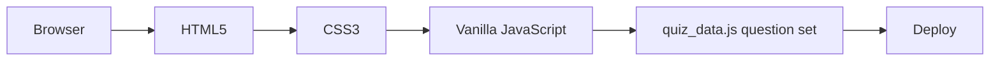
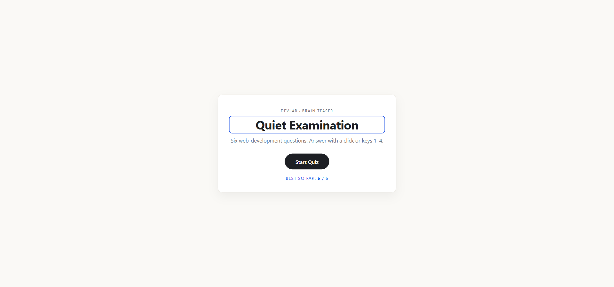
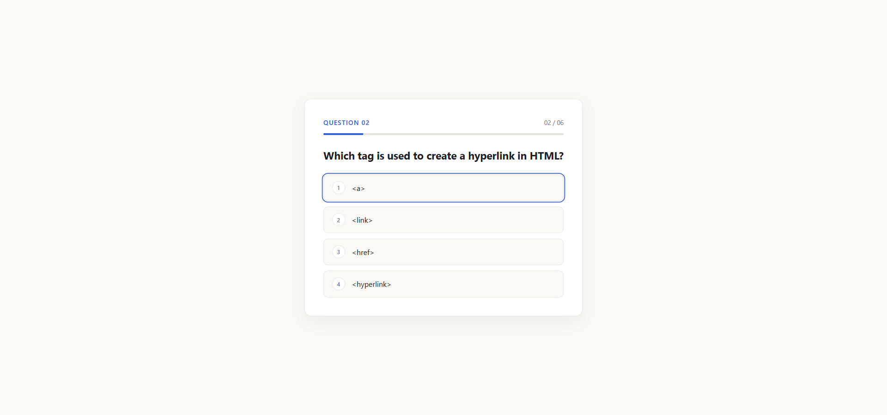
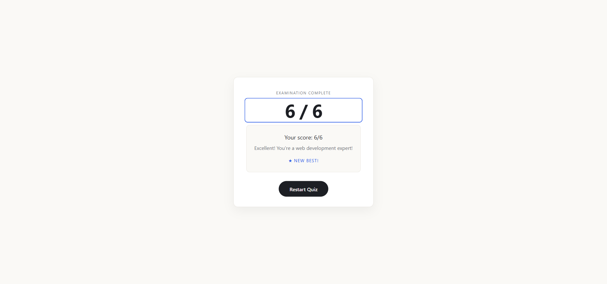

<h1 align="center">Quiz App</h1>

<p align="center"><b>A multiple-choice quiz with immediate feedback, live progress and a scored result screen.</b></p>

<p align="center">


</p>

<p align="center"><a href="#quick-start">Quick start</a> &nbsp;·&nbsp; <a href="#features">Features</a> &nbsp;·&nbsp; <a href="#architecture">Architecture</a> &nbsp;·&nbsp; <a href="#faq">FAQ</a></p>

## Overview

A three-screen quiz app that walks through a question set one question at a time. Answer, get instant feedback, see where you are in the set, and finish on a scored summary.

Questions live in a separate `quiz_data.js` file, so the question set can be swapped or extended without touching the quiz logic — the app just reads the array.

Built as part of the DevLab internship programme.

## At a glance

| Field | Detail |
| --- | --- |
| **Type** | Static site — no build step |
| **Primary language** | JavaScript |
| **Live demo** | https://quiz-app-devlab-tawny.vercel.app |
| **Repository** | [Mister2314/quiz-app-devlab](https://github.com/Mister2314/quiz-app-devlab) |

## Features

- Three screens — start, question and result — swapped in place
- Questions loaded from a separate `quiz_data.js` data file
- Immediate right / wrong feedback on each answer
- Live question counter and progress indicator
- Score summary on the result screen
- Restart without reloading the page
- High score kept in `localStorage`

## Tech Stack

| Layer | Technology |
| --- | --- |
| Markup | HTML5 |
| Styling | CSS3 |
| Logic | Vanilla JavaScript |
| Data | `quiz_data.js` question set |

## Architecture



## Screenshots

| Screen | What it shows |
| :---: | --- |
|  | Start screen |
|  | Question with feedback |
|  | Scored result |

## Quick Start

```bash
git clone https://github.com/Mister2314/quiz-app-devlab.git
cd quiz-app-devlab

# open it directly
start index.html      # Windows
open  index.html      # macOS

# or serve the folder
npx serve .
```

## Project Structure

```
index.html — the three screens
script.js — quiz flow, scoring and screen switching
quiz_data.js — questions, options and correct answers
style.css — layout and state styling
screenshots/ — start, question and result screens
```

## FAQ

<details>
<summary><b>Where do the questions come from?</b></summary>

A separate `quiz_data.js` file. The quiz logic reads that array and never hard-codes a question, so the set can be swapped without touching `script.js`.

</details>

<details>
<summary><b>How does the screen switching work?</b></summary>

Three `<div>` sections — start, question, result — and one function that toggles which is visible. There is no router and no framework.

</details>

<details>
<summary><b>Is the score saved?</b></summary>

The high score is written to `localStorage`, so it survives a reload. The current run is not — refreshing mid-quiz restarts it.

</details>

## Roadmap

- [ ] Save an in-progress attempt so a refresh does not lose it
- [ ] Add a per-question review on the result screen
- [ ] Add a shuffle option for question order

## Notes

Built during the **DevLab** internship programme. Keeping the questions in their own file meant the app itself never had to change as the question set grew.

## Author

**Xəyal Hüseynli** — Junior Front-End Developer

[Portfolio](https://hypnosdev.vercel.app) · [GitHub](https://github.com/Mister2314) · [LinkedIn](https://www.linkedin.com/in/x%C9%99yal-h%C3%BCseynli-3487b91ba/) · [xeyalhuseynli06@gmail.com](mailto:xeyalhuseynli06@gmail.com)
